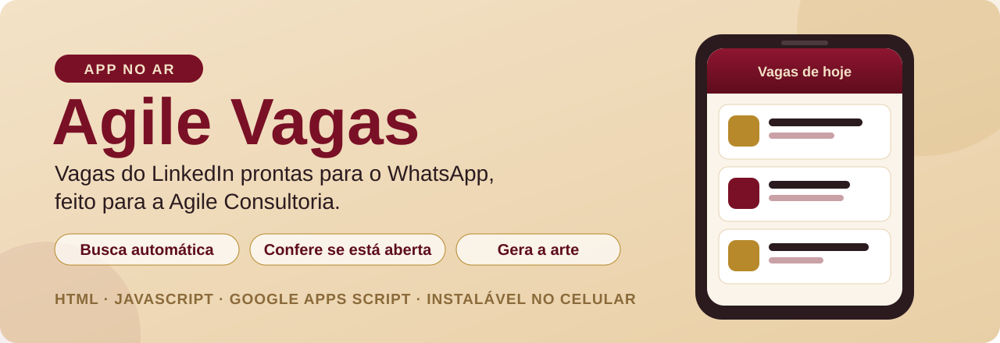

  

  
  
  

### Oi, eu sou o Leonardo 👋

Sou empresário de tecnologia e fundador da **[Pania Company](https://www.paniacompany.com.br)**, que atende
outras empresas em três frentes: **monitoramento** de servidores e sites, **sistemas de PDV** e **criação de sites**.

A ideia da Pania nasceu na pandemia, vendo de perto negócios que não podiam parar e precisavam de tecnologia
confiável. Em 2024 ela virou empresa, e o propósito continua o mesmo: deixar o cliente cuidar do negócio enquanto
a tecnologia trabalha a favor dele.

Além de tocar a empresa, coloco a mão na massa: vários projetos daqui nasceram de problemas reais de clientes,
e nas horas vagas estou criando o meu próprio jogo.

- 🏢 **Fundador:** Pania Company · observabilidade com Zabbix e Grafana, PDV e sites
- 💼 **Para clientes:** o Agile Vagas, app que busca vagas e prepara as postagens de um grupo de empregos
- 🎮 **Projeto pessoal:** Sombras da Escola, jogo 3D multiplayer para Android feito em Godot 4
- 📬 **Fale comigo:** pelo site [paniacompany.com.br](https://www.paniacompany.com.br)

---

## 🚀 Projetos em destaque

<table>
  <tr>
    <td colspan="2">
      
      <h3>🦁 Pania Company</h3>
      
A empresa de tecnologia que eu fundei. Monitoramento 24 horas de servidores, sites e sistemas com Zabbix e Grafana
      e alertas no WhatsApp, sistemas de PDV com implantação e treinamento, e sites de landing page a e-commerce.

      <a href="https://www.paniacompany.com.br"><b>Conhecer a Pania Company →</b></a>
    </td>
  </tr>
  <tr>
    <td width="50%" valign="top">
      
      <h3>🥷 Sombras da Escola</h3>
      
Jogo 3D de esconde-esconde para Android. Os ninjas se disfarçam de objetos da escola e o policial
      precisa encontrá-los antes do tempo acabar. Tem sirene nas salas, prisão e uma chave de resgate.

      

        
        
        
        
      

      <a href="https://github.com/Leonardo-Pania/sombras-da-escola"><b>Ver o projeto →</b></a>
    </td>
    <td width="50%" valign="top">
      
      <h3>💼 Agile Vagas</h3>
      
App feito para a Agile Consultoria. Busca vagas do LinkedIn em Matão, Araraquara, São Carlos e
      Taquaritinga, confere se ainda estão abertas e gera a arte e a mensagem de cada vaga para o grupo.

      

        
        
        
      

      <a href="https://github.com/Leonardo-Pania/agile-vagas"><b>Ver o código →</b></a> ·
      <a href="https://leonardo-pania.github.io/agile-vagas/#demo"><b>Abrir a demonstração →</b></a>
    </td>
  </tr>
</table>

---

## 🧰 Com o que eu trabalho

**Infraestrutura e monitoramento** 

**Sites e apps** 

**Jogos e ferramentas** 

## 📊 No GitHub

  
  

---

  

